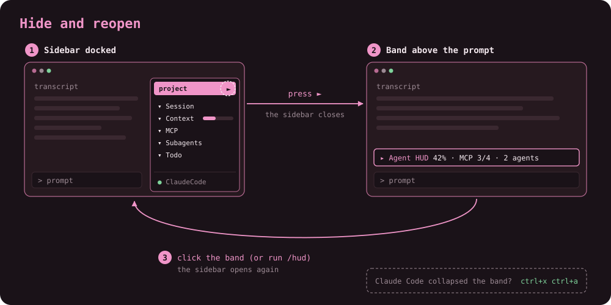

# Agent HUD

<a href="https://github.com/GolemTech/agent-hud/blob/main/LICENSE"></a>

A live sidebar for Claude Code. It docks beside the transcript and shows the
current session at a glance: who and where you are, how much context and
rate limit is left, which MCP servers are connected, what your subagents are
doing, and the main loop's todo list.

<p align="center">
  
</p>

The recording uses `/hud-demo` (fictional sample data, no tokens spent) on a
signed-out Claude Code profile. To re-record it, run `docs/record-demo.sh`
from the repository root (needs `vhs`, `ffmpeg` and `gifsicle`).

## What the sidebar shows

| Section   | Contents |
| --------- | -------- |
| Header    | Always at the top: the project's name (`📂`, the repository root's folder, else the working directory's, after `🔒` in privacy mode), centered in a full-width band that ends in the `⋮` settings button. |
| Session   | Session title (or short id), signed-in account, model and effort, output style (when not the default), git branch (`⑂`) with commits against its upstream (`↑N` to push, `↓M` to pull, each shown only when above zero) and working-tree changes (`+N` added, `-M` removed lines, shown only when there are any), working directory shortened to fit. |
| Context   | `━` meters (`▬` if chosen in the settings block) for the context window and each rate-limit window, with time to reset and the local reset time; a footer with total tokens and cost. |
| MCP       | MCP servers, connected first; servers waiting for authentication are dimmed. `[active]` / `[all]` in its header filters the list. |
| Subagents | Running / done / error counts, then one card per subagent: description, type, model, elapsed time and context tokens. Past 12 rows the cards scroll in a window of their own. |
| Todo      | The main loop's task list: done first, then in progress, then pending. Past 5 rows it scrolls in a window of its own. |
| Gentle AI | The [gentle-ai](https://github.com/Gentleman-Programming/gentle-ai) toolset: one aligned grid in four groups. **Tools**: `gentle-ai`, `gga` and `engram` versions with `✓` up to date or `↑ <newer>` (as fresh as your local brew tap); **gga**: the review hook and its rules file; **RDD**: receipt-driven development on or off and which scope decides it, then each scope's own setting; **TDD**: test-first by default under ODD, and strict TDD. One status vocabulary throughout: `✓` ok, `✗` missing, `↑` update, `●` on, `○` off, `—` unset, `?` unknown. Shows "gentle-ai not installed" when it is not. |
| Footer    | Always at the bottom: the Claude Code version (`● ClaudeCode x.y.z`). |

## How it works

<p align="center">
  
</p>

Details and limits are in [How it gets its data](#how-it-gets-its-data).

## Install

Requirements: Claude Code 2.1.295 or newer. On an older version the sidebar
shows only a notice asking you to run `claude update`.

At the prompt of a Claude Code terminal session:

```
/plugin install agent-hud --marketplace GolemTech/agent-hud
```

Answer `y` to add the marketplace, then choose a scope (user scope is first).
The sidebar becomes active in that session without a reload.

To add the marketplace first and install separately:

```
/plugin marketplace add GolemTech/agent-hud
/plugin install agent-hud@agent-hud
```

## Usage

- The sidebar opens on session start. `/hud` opens it again at any time.
- `⋮` (right end of the header band, padded to a fixed 7-cell click target,
  `'   ⋮   '`) opens the settings block at the top of the sidebar: the current theme with `[change]` (opens the theme picker) and
  `[close]`. `⋮` again closes it; it opens scrolled to the top, and it never
  shows together with the theme picker (`⋮` closes the picker without saving).
  `Meters` picks the meter glyph, one choice per line, aligned under the
  theme name: `[✓ line ━━━]` (the default) or `[  block ▬▬▬]`, for fonts
  where one draws better than the other; the choice is saved for later
  sessions and applies to demo mode too.
  `Sections` lists one check per line, aligned under the theme name
  (`[✓ Todo]` shown, `[  Todo]` hidden): an unchecked section is not drawn at all, collapsed or not (showing
  it again restores its collapsed state) and drops its part from the band's summary; hiding Context,
  MCP and Subagents leaves the band with only `▸ Agent HUD`. With every
  section hidden the sidebar reads `all sections hidden · ⋮ to show`. The
  choice is saved for later sessions; hidden sections keep being polled, so
  showing one again is instant.
- The close mark Claude Code draws on the sidebar's frame (or `ctrl+x x`)
  hides it. A band above the prompt then shows a one-line summary
  (`▸ Agent HUD  55% · MCP 3/4 · 2 agents`); click it to reopen the sidebar.
- Claude Code can collapse that band itself, showing
  `plugin panel hidden · ctrl+x ctrl+a or click to show`. Click it or press
  `ctrl+x ctrl+a` to expand it.

  
- `▾` / `▸` on each section header collapses or expands that section.
- The sidebar adapts to the dock's width and height on every resize: labels
  keep their width and buttons wrap below them, meter bars scale, the
  subagent tally turns compact (`●2 ✓5 ✕0`) in a narrow dock, and the
  Subagents and Todo windows keep their height.
- In the dock, the header and footer stay put like a web page's: the sections
  scroll between them with the mouse wheel or the scroll keys, and at the end
  a blank row is left under the last line. A narrower or collapsed content
  pulls the scroll back so it never points past the end. In an inline frame
  the sidebar is drawn as one plain flow.
- Long lists stay short: Subagents draws in a window of 12 rows and Todo in
  one of 5, whole cards and todos only, with `↑ N more` / `↓ N more` lines
  counting the items hidden on each side. A list that fits draws as before,
  with no window. The mouse wheel over a list scrolls that list; anywhere
  else, and with the scroll keys, it scrolls the sidebar. Each window follows
  the active item (the todo in progress, the first running subagent) until
  you scroll it, and follows again once another item is active.
- `✕ clear done` on Subagents and Todo removes finished entries.
- `[active]` / `[all]` on the MCP header show only connected servers or every
  server (the default). Under `active`, a line counts the hidden ones
  (`1 hidden`), or reads `no active servers · 2 hidden` when none is
  connected. The choice is saved for later sessions.
- `/hud-demo` toggles a sample session (fixed data, progressing subagents
  and todos) for demos and screenshots. It spends no tokens and shows no
  personal data; run it again to return to the live session.
- `/hud-private` toggles privacy mode for screen sharing and streaming. The
  sidebar stays live (model, context, rate limits, cost, MCP, subagents,
  todos), but the account shows as `you@example`, the session title as
  `private session`, the session id is hidden, the branch shows as `••••` and
  the path and the header's project name as `~/…` and `…`; a `🔒` before the project name in the header band shows it is on.
  It persists across plugin reloads until you run it again. MCP server names,
  subagent descriptions and todo text are **not** masked, and can contain
  project or client names. Claude Code's own welcome header and status line are
  not affected either: a plugin cannot draw them.
- Gentle AI section:
  - `↻` checks again now (otherwise at session start and about every 5
    minutes, and after each action).
  - Command buttons ask first: `[install]` (gga pre-commit hook, `gga install`),
    `[init]` (sample `.gga`, `gga init`, only when the project has none), and
    RDD `project [on] [off]` / `global [on] [off]` (the current value is marked `[● on]`)
    (`gentle-ai review mode enable|disable --scope clone|global`). Nothing runs
    unless you choose **Run it**; a short toast says how it went. Off always
    wins: a project "on" cannot override a global "off".
  - Prompt buttons only fill the prompt box, they never send it:
    `[create rules]` (asks Claude to write the gga rules file) and
    `[configure]` (asks Claude to set up strict TDD through the sdd-init flow).
    Review the text and press Enter yourself.
  - In demo mode the section shows sample values and its buttons do nothing.

## Themes

`/hud-theme` without a name opens a picker at the top of the sidebar, like
Claude Code's `/theme`, at any terminal width: each theme is listed in its own
accent color, the saved one marked `●`, and the sections stay drawn below it. The dark themes come first, then a `light` line, then the light themes. The list shows ten rows at a time, with `↑ N more` / `↓ N more` lines naming the rest; it follows the highlighted theme, and the mouse wheel over the sidebar scrolls it while the picker is open, so the sections below stay in view. `[change]` in the `⋮` settings block opens the same picker.
Moving through the list previews each theme on the sidebar itself, and it
wraps around: down from the last theme lands on the first, up from the first
on the last. Enter (or a click) applies and saves it; `c` (or clicking
**Cancel**) goes back to the saved theme. Esc hands the keys back to the prompt and the sidebar
shows the saved theme again; the picker stays until you choose or cancel. If
moving does nothing, the sidebar does not hold the keys: press `ctrl+x tab` or
click it. The command also prints the list, for a session that shows no panes.

`/hud-theme <name>` sets a theme directly. Names are case-insensitive, and
spaces or underscores work for hyphens (`/hud-theme tokyo night`).

| Theme | Notes |
| --- | --- |
| `default` | Claude Code's own theme colors; follows `/theme`, light or dark |
| `one-dark-pro`, `catppuccin-mocha`, `gruvbox-dark`, `dracula`, `nord`, `tokyo-night`, `solarized-dark`, `rose-pine`, `kanagawa`, `monokai` | Dark: fixed colors from each theme's palette |
| `everforest-dark`, `ayu-dark`, `github-dark`, `catppuccin-macchiato`, `material-ocean`, `night-owl`, `nightfox`, `oceanic-next`, `horizon`, `synthwave-84` | Dark: fixed colors from each theme's palette |
| `catppuccin-latte`, `solarized-light`, `github-light`, `gruvbox-light`, `one-light`, `rose-pine-dawn`, `ayu-light`, `everforest-light`, `tokyo-night-day`, `nord-light` | Light: fixed colors and the theme's own text color |

The choice is saved and applies to every later session until you change it.
Each preset also fills the sidebar and the band above the prompt with its
editor background (for example `#282a36` for `dracula`), and a preview changes
it too; `default` keeps your terminal's own background. A light preset also
draws plain text in its own text color (for example `#1f2328` for
`github-light`), so it stays readable whatever your terminal's text color is;
`default` and the dark presets keep your terminal's text color. Every color
reads at least 3:1 against its background, and a light theme's text 4.5:1. To
get there, a few light themes use a darker shade of an upstream color (for
example `catppuccin-latte`'s yellow); `nord-light` is built from the Nord
palette, which has no official light variant.

## How it gets its data

Most values come from the plugin API (`$.session`, `$.agent`, `$.tool`). The
rest, and the limits that come with them:

- **Per-subagent tokens** are the context size of the subagent's latest
  request, read from that request's own usage (`turn.step`), so they update
  after every request. A turn's usage is not used: it sums every request's
  counts, each of which re-reads the cached context, and runs into millions.
- **Todos** mirror the main loop's `TodoWrite`, `TaskCreate` and `TaskUpdate`
  calls only, and only those made after the plugin loads. Subagents' own lists
  are ignored.
- **Session title** is read from Claude Code's internal file
  `~/.claude/projects/<project>/<session>/custom-title.json`. If that file
  moves or changes shape, the short session id is shown instead.
- **Account** is read from the `oauthAccount` field of `~/.claude.json` and
  shown as `user@Organization`, or only the email's user part when there is no
  organization; the email domain is never shown and nothing else in that file
  is used. When `CLAUDE_CONFIG_DIR` is set (a leading `~` is expanded), both
  files are read from that folder instead.
- **Git branch** comes from `git branch --show-current`, refreshed about every
  5 seconds.
- **Working-tree changes** come from `git diff --shortstat HEAD` on the same
  cadence: staged and unstaged lines added and removed against `HEAD`.
  Untracked files are not counted, and nothing shows in a repository with no
  commit yet.
- **Commits ahead and behind** come from
  `git rev-list --left-right --count HEAD...@{upstream}` on the same cadence.
  The HUD never runs `git fetch`, so `↓` is as of your last fetch. Nothing
  shows for a branch with no upstream or a detached `HEAD`. Privacy mode keeps
  these counts, like the change counts: they name nothing.
- **Output style** is the one Claude Code composes each request's system
  prompt with, observed on `prompt.compose` without changing the prompt.
  Before the first request it is read from the `outputStyle` setting
  (`.claude/settings.local.json`, then `.claude/settings.json` in the
  repository root, then the user `settings.json`, which also follows
  `CLAUDE_CONFIG_DIR`), about every 30 seconds; nothing else in those files is
  used. The default style shows no line. A request composed with no style
  cannot be told from a subagent's (whose requests carry none), so it does not
  clear the line; switching back to the default shows instead when the setting
  changes (within about 30 seconds). A default style chosen some other way
  than the settings files (for example a launch flag) is not seen until a
  named style replaces it. Privacy mode leaves the style and the
  change counts visible: they are not identity.
- **Reset times** use the system UTC offset from `date +%z`.
- **Dock width** cannot be forced by a plugin; a width you set wins.
- **Gentle AI versions** come from `brew list --versions` and
  `gentle-ai --version`. **Update status** comes from
  `brew outdated --json=v2` run with `HOMEBREW_NO_AUTO_UPDATE=1`: it compares
  against your local tap metadata, so it is only as fresh as your last
  `brew update`, which refreshes it. Tools not
  installed through brew show no update status.
- **gga** is detected by reading files, never by running gga (its commands
  check GitHub for updates, and `gga config` executes the project's `.gga`):
  the hook from the `pre-commit` / `commit-msg` files in the repository's
  hooks folder (the `core.hooksPath` set in the repository's own config file,
  else `<git common dir>/hooks`; Claude Code runs git with `core.hooksPath`
  forced to `/dev/null`, so git cannot be asked for it), the configuration from the project `.gga`
  over `~/.config/gga/config` (`XDG_CONFIG_HOME` respected), parsed as plain
  text and never executed, and the rules file (`RULES_FILE`, default
  `AGENTS.md`) by checking that it exists. A `RULES_FILE` that is not a plain
  relative file name is ignored: `AGENTS.md` is checked and shown instead,
  with the note "RULES_FILE ignored". The hook counts as installed when
  a hook file holds gga's block marker, or a legacy unmarked `gga run` /
  `ai-code-review run` line; a mere mention of either name does not count.
- **RDD** comes from `gentle-ai review mode status --json` (read only).
- **TDD**: "test-first (ODD)": test-first is the default of
  gentle-ai's Organic Driven Development workflow; strict TDD is `strict_tdd` in
  the project's `openspec/config.yaml`, matched as text (quoted or not,
  `true`/`false` or YAML `yes`/`no`/`on`/`off`, an inline `# comment`
  allowed; a commented-out line does not count).
- **No network calls** are made by the plugin itself.
- **Control characters** (escape sequences, newlines, bells) are stripped from
  every displayed string that comes from outside the plugin.

## Security and privacy

What the plugin reads, keeps and shows, and how to report a vulnerability:
see [SECURITY.md](SECURITY.md).

## Development

```sh
claude --plugin-dir .          # run a session with the plugin loaded from this folder
claude plugin test .           # run hooks/*.test.ts against the engine
claude plugin validate .       # check manifest, marketplace and hooks module
npx -y -p typescript@5.6.3 tsc -p . --noEmit   # type-check
```

Type-checking needs `.claude-plugin/types/`, which Claude Code writes when a
session loads the plugin from this folder (`claude --plugin-dir .`). It is
git-ignored.

## Credits

[](https://github.com/Gentleman-Programming/gentle-ai)

## License

[MIT](LICENSE) © GolemTech

Not affiliated with or endorsed by Anthropic. Claude and Claude Code are trademarks of Anthropic, PBC.
